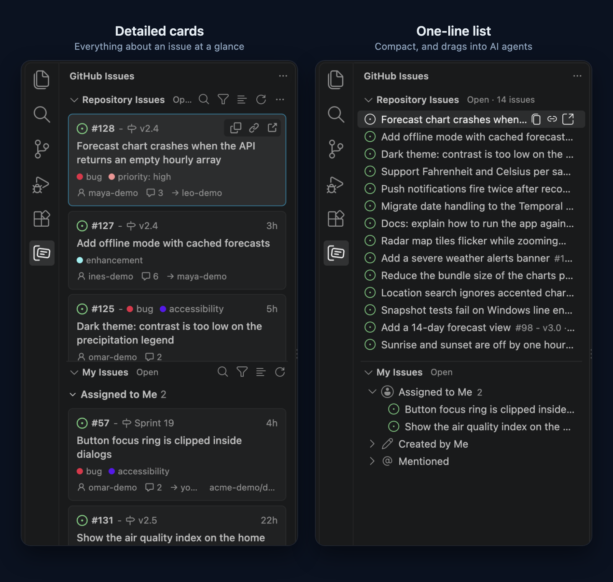
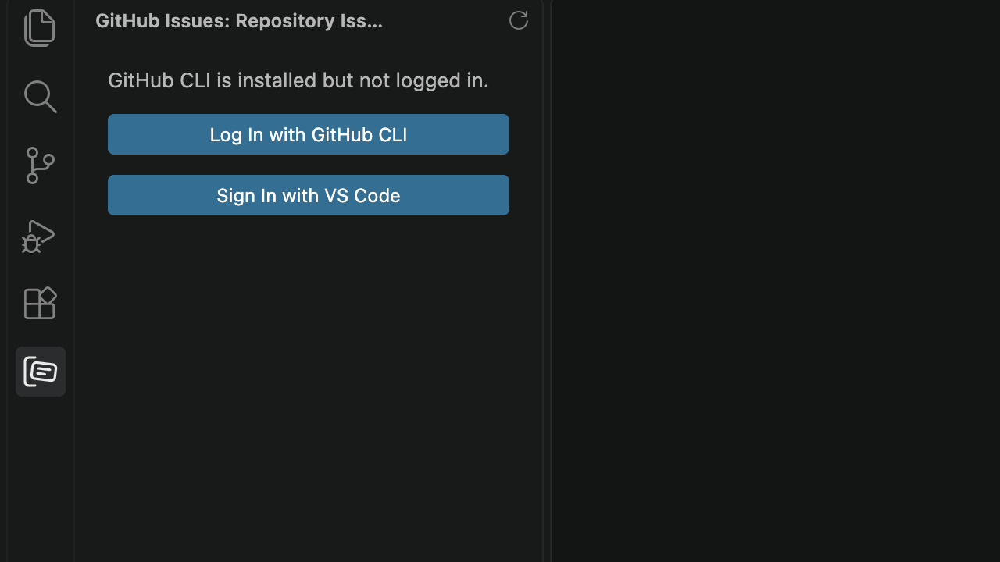
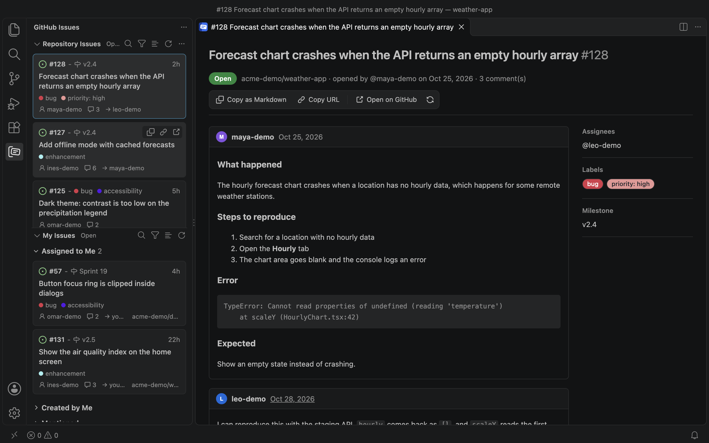
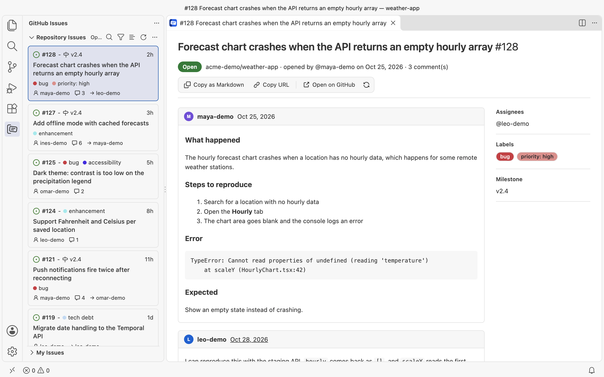
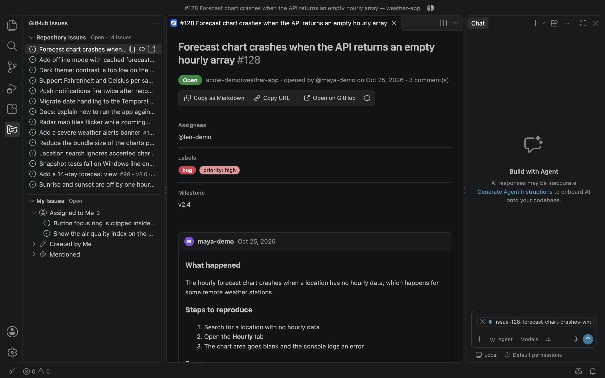
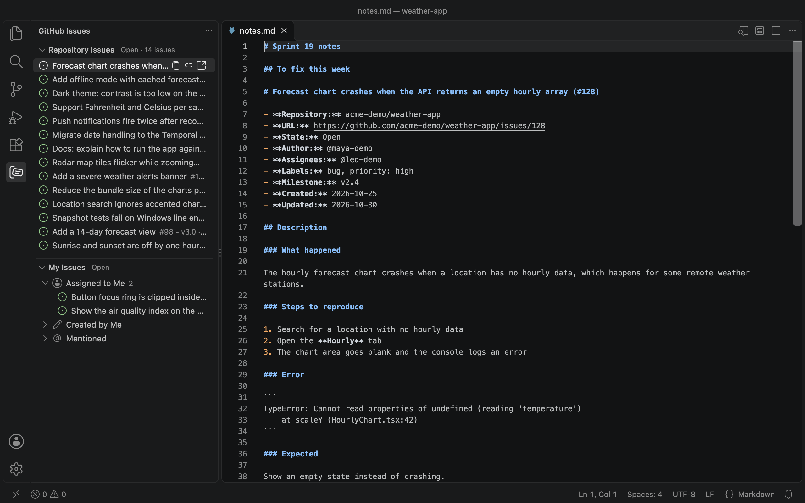
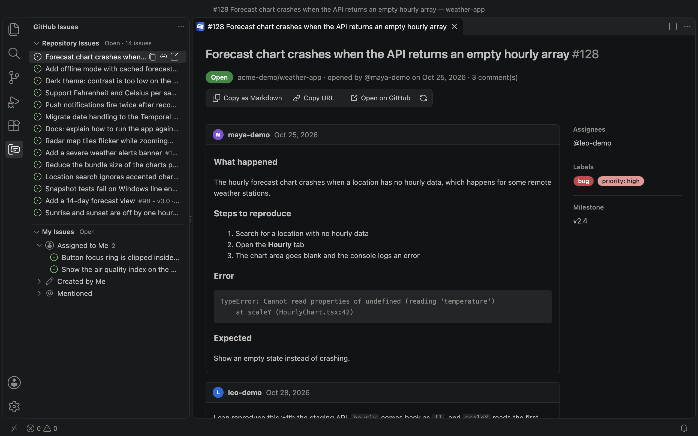
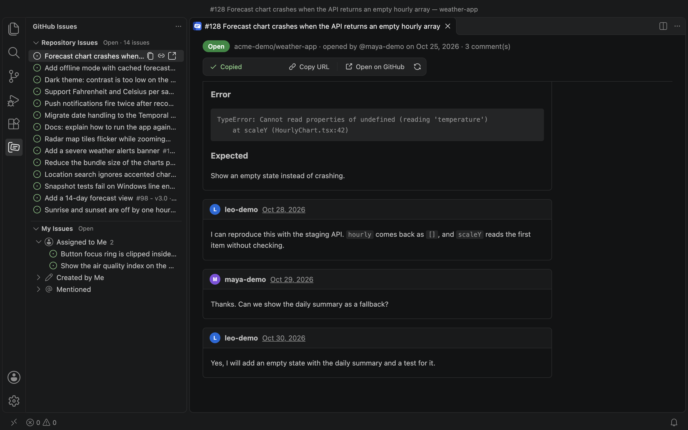

# GitHub Issues Sidebar

Browse GitHub issues in the VS Code sidebar, read them in full, and hand them to an AI agent by drag and drop or as Markdown.



## Features

- **All your issues in one place.** See every issue for your workspace's repositories, plus what is assigned to you, created by you, or mentions you.
- **Drag issues into AI agents.** Drop an issue on an agent's input and it arrives as context, with its description and comments.
- **Two styles.** Use a compact one-line list, or detailed cards with labels, milestones, assignees and comment counts.
- **Full issue details.** Read the rendered description and every comment without leaving the editor.
- **Copy as Markdown or copy the URL.** Available from any issue, on one issue or a multi-selection in the list.
- **Filter and search.** Switch between open, closed and all, or use GitHub search syntax such as `label:bug author:octocat`.

## Getting started

Open the **GitHub Issues** icon in the activity bar.

- If the [GitHub CLI](https://cli.github.com) is installed and logged in, there is nothing to set up.
- If `gh` is logged out, choose **Log In with GitHub CLI**.
- If you don't use `gh`, choose **Sign In with VS Code**.



Repositories are detected from your workspace's git remotes. Forks show the parent repository's issues. To add others, use **Add Repository…** in the view's `…` menu.

## Two styles

Switch with the button in the view's title bar, or with the `ghIssues.issueStyle` setting.



| | One-line list (default) | Detailed cards |
|---|---|---|
| Shows | Title, `#id`, milestone or labels | State, `#id`, milestone, labels, title, author, comments, assignees |
| Drag out | Yes | No |
| Multi-select | Yes | No |
| Copy actions | Hover, right-click and `Cmd/Ctrl+C` | Hover and `Cmd/Ctrl+C` |

VS Code only allows dragging from its native one-line rows, so use the list style when you want to drag.

Both styles follow your color theme.



## Drag and drop

In the one-line list, drag an issue or a multi-selection onto any of these.

| Drop on | Hold Shift? | Result |
|---|---|---|
| VS Code Chat | No | Attaches the issue |
| An agent input in a webview, such as Claude Code | Yes | Mentions the issue |
| A text editor | Yes | Inserts the issue as Markdown, with an option to insert a link instead |
| An editor, without Shift | No | Opens the issue as a Markdown file |
| A terminal | No | Pastes the path to the issue's Markdown file |





Each dragged issue is written to a Markdown file in the extension's storage folder, which is what lets agents accept it. The Explorer doesn't accept drops from other views.

## Issue details

Click an issue to read it. The toolbar stays in view as you scroll, with **Copy as Markdown**, **Copy URL**, **Open on GitHub** and **Refresh**.





## Settings

| Setting | Default | Purpose |
|---|---|---|
| `ghIssues.issueStyle` | `list` | `list` or `cards` |
| `ghIssues.repositories` | `[]` | Extra repositories, as `owner/name` |
| `ghIssues.maxIssuesPerList` | `1000` | Issues loaded automatically per list. Larger lists show **Load more**. |
| `ghIssues.includeComments` | `true` | Include comments in Markdown |
| `ghIssues.ghPath` | empty | Path to `gh`, if it isn't found automatically |

## Good to know

- Only github.com is supported, not GitHub Enterprise Server.
- GitHub limits search results to 1,000.
- Issue text is written by anyone who can open an issue. Review what you hand to an agent that can run commands, since an issue may contain instructions aimed at it.

## Development

```sh
pnpm install
pnpm build       # bundle the extension and webview scripts
pnpm test        # unit tests
pnpm typecheck
pnpm package     # build a .vsix
```

Press `F5` in VS Code to run the extension in a development window.
